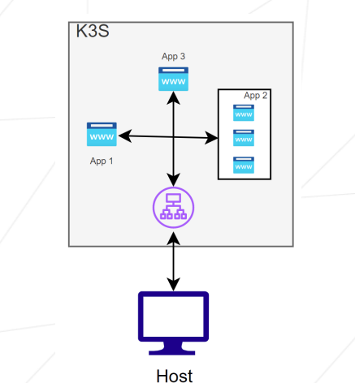
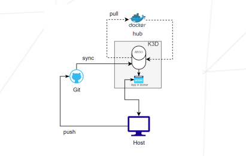

# Inception-of-Things

Hands-on Kubernetes and GitOps with **K3s, K3d, Vagrant and Argo CD**, built from scratch in four parts. The goal is a small cluster that you can create with one command, route traffic into, and deploy to from Git.

| Part | Folder | What it builds | Key tools |
|---|---|---|---|
| 1 | [`p1/`](p1) | Two-node K3s cluster (server + agent) | Vagrant, K3s |
| 2 | [`p2/`](p2) | Three apps behind one ingress, routed by host | K3s, Ingress |
| 3 | [`p3/`](p3) | Continuous deployment from a Git repository | K3d, Argo CD |
| Bonus | [`bonus/`](bonus) | Self-hosted GitLab inside the cluster | Helm |

## Repository layout

```
.
├── p1/                   Two-VM K3s cluster
│   └── Vagrantfile
├── p2/                   Ingress routing demo
│   ├── Vagrantfile
│   ├── scripts/setup.sh
│   └── confs/            app1.yaml app2.yaml app3.yaml ingress.yaml
├── p3/                   GitOps with Argo CD
│   ├── scripts/          setup.sh (dependencies and cluster), build.sh (Argo CD)
│   └── config/           application.yaml (Argo CD Application)
├── bonus/                GitLab on K3d
│   ├── scripts/setup.sh
│   └── config/
└── assests/              Screenshots used below
```

## Part 1: K3s cluster with Vagrant

`p1/Vagrantfile` creates two VirtualBox VMs on a private network:

| Node | Role | IP | Resources |
|---|---|---|---|
| `*S` | K3s server (control plane) | 192.168.56.110 | 1 CPU, 512 MB |
| `*SW` | K3s agent (worker) | 192.168.56.111 | 1 CPU, 512 MB |

The server installs K3s, writes the node token to a shared folder, and the agent reads it to join the cluster. No manual steps in between.

```bash
cd p1 && vagrant up
vagrant ssh <server-name> -c "kubectl get nodes -o wide"
```



## Part 2: three apps, one ingress

`p2/` runs one K3s server VM (Debian, 1 CPU, 1 GB) and deploys three applications behind a single Ingress. Routing is decided by the `Host` header:

| Request host | Backend | Replicas |
|---|---|---|
| `app1.com` | `crccheck/hello-world` | 1 |
| `app2.com` | `httpd` | **3** |
| anything else | `nginx` (default rule) | 1 |

```bash
cd p2 && vagrant up
curl -H "Host: app1.com" http://192.168.56.110
curl -H "Host: app2.com" http://192.168.56.110
curl http://192.168.56.110            # falls through to app3
```

This shows host-based routing, Services, and scaling a Deployment with replicas.

## Part 3: GitOps with Argo CD

`p3/` swaps Vagrant for **K3d** (K3s in Docker) and installs **Argo CD** in its own namespace.

- `scripts/setup.sh` installs Docker, curl, K3d and kubectl, then creates the `dev-cluster` cluster (ports 8080 and 8443 mapped to the load balancer).
- `scripts/build.sh` installs Argo CD, creates the `argocd` and `dev` namespaces, and prints the initial admin password.
- `config/application.yaml` is the Argo CD `Application`. It watches a Git repository and syncs it into the cluster with `CreateNamespace=true` and `Prune=true`, so deleting a manifest in Git deletes it in the cluster.

The loop: change the manifest in Git, push, Argo CD notices and syncs. Two image versions (`v1` and `v2`) let you watch a rollout happen.

```bash
cd p3
sudo ./scripts/setup.sh      # dependencies and cluster
./scripts/build.sh           # Argo CD
kubectl apply -f config/application.yaml
```



## Bonus: GitLab on the cluster

`bonus/scripts/setup.sh` installs Helm and deploys the official GitLab chart into a `gitlab` namespace, then prints the initial root password. The goal was to run the whole workflow locally with GitLab as the Git source.

## Requirements

Linux or macOS with VirtualBox and Vagrant (parts 1 and 2), and Docker (part 3 and bonus). The setup scripts install K3d, kubectl and Helm for you on Debian or Ubuntu.

## What I learned

- How a K3s control plane and an agent find each other, and what a node token is.
- How an Ingress controller chooses a backend, including default rules.
- Why GitOps beats `kubectl apply` by hand: Git is the source of truth, and drift gets corrected.
- Debugging a cluster from the node up: network, container runtime, then Kubernetes objects.

## Known limitations

- Credentials and hostnames in the scripts are lab defaults. Do not reuse them outside a local environment.
- Scripts are interactive (`read` prompts) and target Debian-based systems.

Built as part of the 1337 (42 Network) curriculum.
